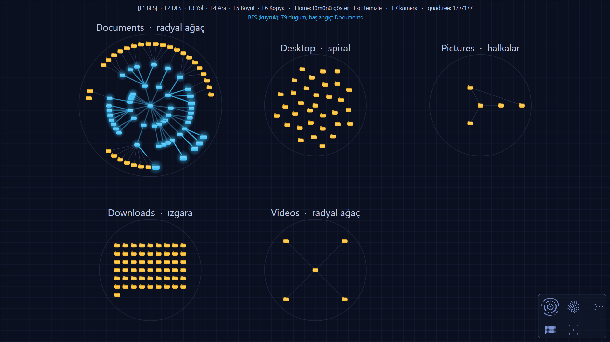

# Graf Tabanlı Dosya Yapısı Görselleştirme ve Gezinme Sistemi

C# WPF ile yazılmış, bilgisayardaki klasörleri **sonsuz kaydırılabilir bir graf** olarak gösteren, üzerinde veri yapıları ve algoritmaların canlı çalıştığı bir uygulama. İsteğe bağlı olarak Lively Wallpaper ile masaüstü duvar kağıdı olarak çalıştırılabilir.

> Ders: Veri Yapıları  
> Hazırlayan: _(Hamza Kahya)_

## Ne yapar?

- Belgeler, Masaüstü, Resimler, İndirilenler gibi klasörleri **ayrı adalar** olarak çizer. Her ada farklı bir yerleşimle (radyal ağaç, spiral, halkalar, ızgara) düzenlenir.
- Fare ile sonsuzca kaydırılır, tekerlekle yakınlaşılır. Yakınlaşınca klasörlerin dosyaları çevresinde belirir.
- `.lnk` kısayolları adalar arasında çapraz kenar olur; ağaç gerçek bir grafa dönüşür.
- İsteğe bağlı kamera modunda vücudunun gölgesi gri zeminde görünür ve klasörleri iter.

## Kullanılan veri yapıları ve algoritmalar

| Yapı / algoritma | Dosya | Nerede kullanılıyor |
|---|---|---|
| Genel ağaç (n-ary) | `FolderTree.cs` | Klasör hiyerarşisini okur |
| Graf (komşuluk listesi) | `Graph.cs` | Klasörler düğüm, ebeveyn-çocuk ve kısayollar kenar |
| BFS (kuyruk) | `Graph.cs` | F1: seviye seviye gezinti animasyonu |
| DFS (yığın) | `Graph.cs` | F2: derinlemesine gezinti animasyonu |
| En kısa yol (BFS + parent tablosu) | `Graph.cs` | F3: iki klasör arası yol |
| AVL ağacı | `AvlTree.cs` | F4: klasör adına göre ön ek arama, doğrusal aramayla süre karşılaştırması |
| Quadtree | `QuadTree.cs` | Ekranda görünen düğümleri ve tıklananı hızlı bulma |
| Max-heap | `GraphView.cs` (`TopByKey`) | F5: en büyük 10 klasör |
| Sıralama (kabarcık, birleştirme, hızlı) | `GraphView.cs` | F5: aynı veride süre karşılaştırması |
| Hash tablosu | `GraphView.cs` (`FindDuplicates`) | F6: aynı ad ve boyuttaki dosyaları bulma |
| Arka plan çıkarma (OpenCV) | `ShadowCamera.cs` | F7: kameradan vücut gölgesi |

### Karmaşıklıklar

| İşlem | Zaman |
|---|---|
| BFS / DFS / en kısa yol | O(V + E) |
| AVL ekleme / arama | O(log n) |
| Quadtree sorgusu | ortalama O(log n + k) |
| Max-heap ile en büyük k eleman | O(n + k log n) |
| Kabarcık / birleştirme / hızlı sıralama | O(n²) / O(n log n) / ortalama O(n log n) |

## Kontroller

| Girdi | Ne yapar |
|---|---|
| Fare sürükle | Düzlemde kaydır |
| Tekerlek | Yakınlaş / uzaklaş |
| Tek tık | Moda göre BFS, DFS, yol seçimi |
| Çift tık | Klasörü veya dosyayı Explorer'da aç |
| F1 / F2 | BFS / DFS |
| F3 | En kısa yol (iki klasöre sırayla tıkla) |
| F4 | AVL ile arama (klavyeden yaz, Backspace siler) |
| F5 | Klasör boyutları ve sıralama yarışı |
| F6 | Kopya dosya bulucu |
| F7 / F8 | Kamera aç-kapat / yeniden kalibre et |
| Home | Hepsini göster |
| Esc | Temizle |

## Çalıştırma

Gereksinimler: Windows 10/11, .NET 8 SDK, Visual Studio 2022.

1. Depoyu indir ve `InfiniteGrid.sln` dosyasını Visual Studio'da aç.
2. NuGet paketleri (`OpenCvSharp4`, `OpenCvSharp4.runtime.win`) otomatik geri yüklenir.
3. **F5** ile çalıştır.

Klasörleri komut satırından seçmek için: `InfiniteGrid.exe "C:\Klasör1" "C:\Klasör2"`. Verilmezse Belgeler, Masaüstü, Resimler, İndirilenler, Müzik ve Videolar taranır. Kamerayı açık başlatmak için `--camera` ekle.

## Duvar kağıdı olarak (isteğe bağlı)

[Lively Wallpaper](https://github.com/rocksdanister/lively) (Store dışı sürüm) ile uygulama duvar kağıdına yerleştirilebilir. Pencerenin tam ekran (`WindowState="Maximized"`) olması gerekir. Lively'de klavye girdisi yoktur, bu yüzden kamera için `--camera` bayrağı kullanılır.

## Ekran görüntüsü

_()_

## Notlar

- Her ada en fazla 300 klasör gösterir, her klasör için en fazla 60 dosya çizilir.
- Kamera görüntüsü kaydedilmez, yalnızca anlık işlenir.